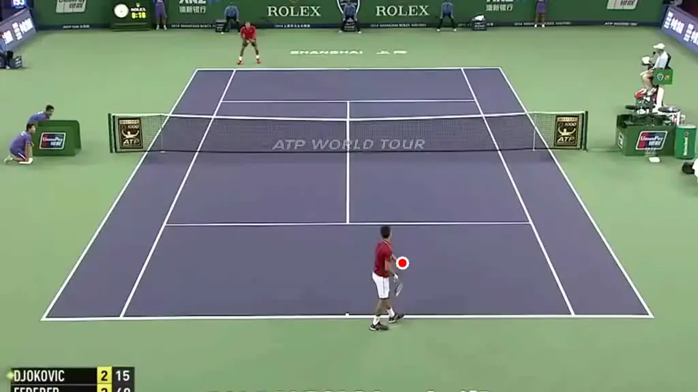
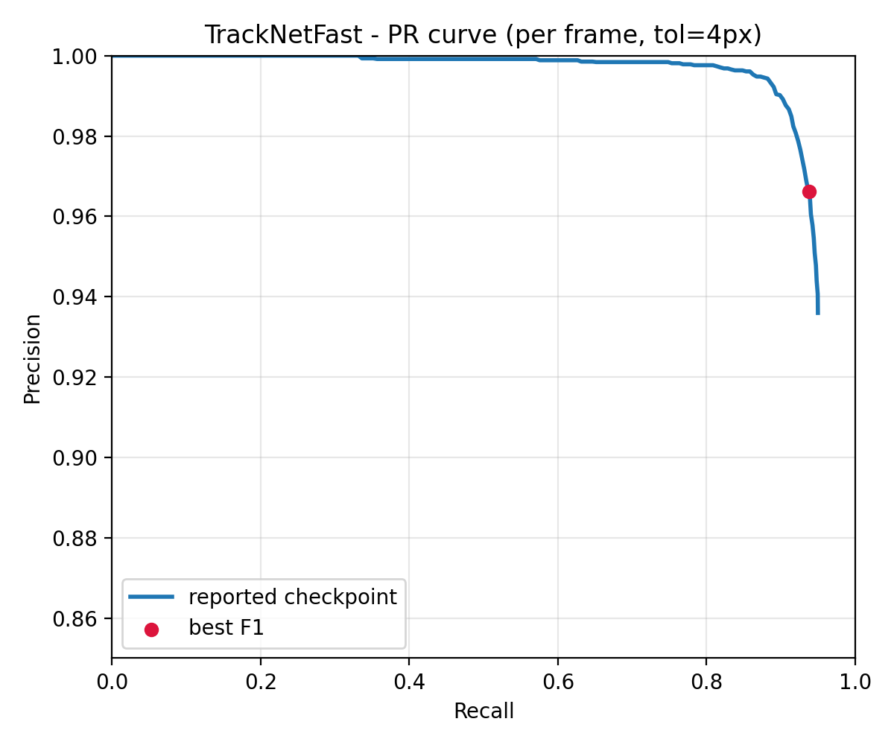
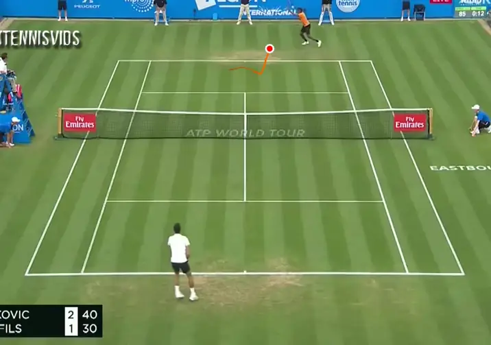

# Tennis Vision: A Fast TrackNet

<p align="center">
  
</p>

A small, fast tennis-ball tracker for three-frame video windows. 

- 288×512 input, three RGB frames.
- 0.9474 AP@4 px per frame on the test set.
- **0.9519 best F1** at a validation visibility threshold.
- **2.6 ms per window** inference time on a Tesla T4 with the static FP16
  TensorRT engine, ~**385 FPS**.

The full method,
targets, losses, decoding, fusion, metric definitions and training details, is
in [METHODOLOGY.md](METHODOLOGY.md).

The model weight can be found [here](https://github.com/mtonell/tennis-vision-tracknet/releases/download/v1.0.0/TrackNetFast.pt).

---

## Architecture

- **Input**: three consecutive RGB frames stacked into `(9, H, W)`. The model standardises each channel and appends two luma-difference
  maps (`|L_t − L_{t−1}|`, `|L_{t−1} − L_{t−2}|`) for a total of 11-channel.
- **Encoder**: MobileNetV3-Large with ImageNet weights. 
- **Heads**: a stride-2 heatmap, a subpixel offset at the argmax cell, and a
  visibility gate derived from each frame's heatmap peak with one learned scale
  and bias.
- **Decoding**: heatmap sigmoid → argmax cell → sigmoid offset inside the cell
  → pixel coordinate; the gate probability is the reported confidence.

## Results

Test split: games 1–2. The checkpoint is at [TrackNetFast.pt](https://github.com/mtonell/tennis-vision-tracknet/releases/download/v1.0.0/TrackNetFast.pt), trained on
games 3–10 for 20 epochs with a cosine learning-rate schedule and batch size 8.


- **Detections fusion**: a frame is predicted by up to three windows.
  Fused detections combine them: majority agreement within
  8 px, else the mean if all agree, else the sharpest heatmap. 

Metrics are reported using a threshold of 0.5.
| protocol | AP@4px | AP@8px | AP@12px | P | R | F1 |
| --- | --- | --- | --- | --- | --- | --- |
| **fusion** | **0.9474** | 0.9632 | 0.9719 | 0.9433 | 0.9488 | 0.9460 |
| **standard (no fusion)** | 0.9339 | 0.9558 | 0.9656 | 0.9339 | 0.9359 | 0.9349 |

**Best-F1 operating point** (threshold tuned on test set, just for deploy, risk of overfitting):

| protocol | threshold | P | R | F1 |
| --- | --- | --- | --- | --- |
| fusion | 0.909 | 0.9662 | 0.9381 | **0.9519** |
| standard | 0.947 | 0.9693 | 0.9187 | 0.9433 |

#### Precision-recall curve

<p align="center">
  
</p>

*PR curve at the 4 px tolerance.*

<p align="center">
  
</p>

*Game 2 / Clip 6: test set clip, after fusion.*

### Latency

TensorRT FP16 static engine on a Tesla T4: inference time per window, batch 1, is **2.6 ms**.

## Install

```bash
pip install -r requirements.txt
```

 TensorRT and ONNX Runtime are only
needed for export/benchmark and are not in `requirements.txt`.

## Dataset

The tennis dataset from the following [repo](https://github.com/yastrebksv/TrackNet). 

```
data/tennis/Dataset/
├── game1/Clip1/{Label.csv, 0.jpg, 1.jpg, ...}
├── game2/...
└── game10/...
```

`Label.csv` needs `file name`, `visibility`, `x-coordinate`, `y-coordinate`.
Labels may be in the source video resolution; each clip is rescaled on the fly.

The split is as follow:

| split | games |
| --- | --- |
| train | 3, 4, 5, 6, 7, 8, 9, 10 |
| test | 1, 2 |

Games 1–2 are also use to pick the operating point. 

## Usage

**Train** the reported recipe:

```bash
python src/train.py --model_name TrackNetFast --epochs 20 --batch_size 8 \
    --optimizer Adam --learning_rate 1e-3 --amp --augment \
    --zoom_scales 1.0,0.9,0.8 --scheduler cosine --min_lr 0 \
    --final_checkpoint last --work_dir ./runs/tracknet_fast
```

**Evaluate** a checkpoint:

```bash
python src/eval.py --model_name TrackNetFast \
    --model_path runs/tracknet_fast/TrackNetFast_epoch_20.pth \
    --batch_size 8 --result_dir ./results
```

**Predict on a video**:

```bash
python src/predict_video.py \
    --model_path runs/tracknet_fast/TrackNetFast_epoch_20.pth \
    --video_path clip.mp4
```

**Exports and Benchmark files**:
```bash
python src/export_onnx.py --help
python src/export_tensorrt.py --help
python src/benchmark.py --help
```

## Models tested

Only **TrackNetFast** is reported. The other architectures from the original
TrackNetV4 repository, and other trials, are kept for comparison under
`src/models/others/`. No numbers are published for them.

## Limitations

- Three-frame input: fast motion and long occlusions can close the gate for
  several consecutive frames.
- The gate is a confidence score, not a calibrated probability.
- As games 1–2 are test, the reported tuned numbers are optimistic for unseen games.

## Citations
Adapted from [TrackNetV4](https://arxiv.org/abs/2409.14543) (Raj et al., 2024) and the [yastrebksv/TrackNet](https://github.com/yastrebksv/TrackNet) dataset.

